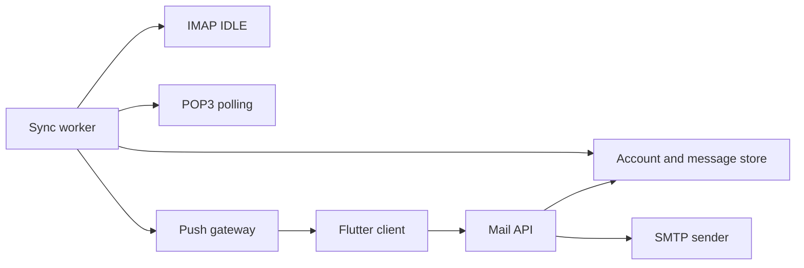

# DailyPostBox

[](https://github.com/littlebit0/DailyPostBox/actions/workflows/ci.yml)

DailyPostBox is a native Flutter email client backed by a realtime mail sync
service. It is designed to connect Gmail, Outlook, Naver, Daum, and custom
IMAP/POP3/SMTP accounts from one application.

> DailyPostBox is under active development and is not ready for production use.

## Highlights

- OAuth browser sign-in for Gmail and Outlook
- IMAP IDLE workers for near-realtime message delivery
- POP3 polling for providers without IMAP support
- SMTP sending through connected accounts
- Account-level sync, validation, import, and removal flows
- Korean and English application UI
- Flutter client targeting Android, iOS, macOS, and Windows

## Architecture



The server keeps long-lived IMAP connections because mobile operating systems
cannot reliably keep them alive in the background. The client receives push
notifications and refreshes its local view through the API.

## Repository Layout

```text
.
├── apps/
│   ├── client/   # Flutter application
│   └── server/   # TypeScript mail API and sync workers
├── .github/      # CI and issue templates
└── README.md
```

## Getting Started

### Requirements

- Flutter stable with Dart 3.6 or later
- Node.js 22 or later
- pnpm through Corepack

### Server

```bash
cd apps/server
cp .env.example .env
corepack enable
pnpm install
pnpm dev
```

The API listens on `http://localhost:4000` by default. OAuth credentials must be
stored in `.env` locally and in a secret manager in deployed environments.

### Client

```bash
cd apps/client
flutter pub get
flutter run --dart-define=MAIL_API_BASE_URL=http://localhost:4000
```

For a deployed build, replace the API URL with the public HTTPS endpoint.
Platform setup details live in [apps/client/README.md](apps/client/README.md).

## Development Status

| Area | Status |
| --- | --- |
| macOS client shell and account UI | Implemented |
| Gmail OAuth browser flow | In progress |
| Outlook OAuth browser flow | Planned |
| IMAP IDLE and SMTP foundation | Implemented |
| Durable database and encrypted token storage | Planned |
| FCM/APNs production push delivery | Planned |
| Android, iOS, and Windows platform packaging | Planned |

See [apps/server/README.md](apps/server/README.md) for API endpoints, provider
support, and deployment notes.

## Security

Never commit OAuth client secrets, mail passwords, refresh tokens, or `.env`
files. Please report sensitive vulnerabilities through GitHub's private
vulnerability reporting instead of a public issue. See [SECURITY.md](SECURITY.md).

## Contributing

Bug reports and focused pull requests are welcome. Read
[CONTRIBUTING.md](CONTRIBUTING.md) before submitting a change.

## License

No open-source license has been selected yet. All rights are reserved.
