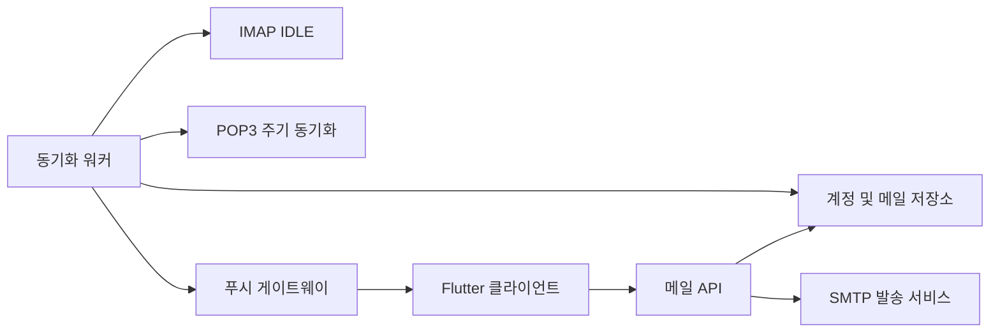

# DailyPostBox

[](https://github.com/littlebit0/DailyPostBox/actions/workflows/ci.yml)

DailyPostBox는 실시간 메일 동기화 서버를 기반으로 동작하는 Flutter 네이티브
이메일 클라이언트입니다. 하나의 앱에서 Gmail, Outlook, 네이버, 다음 및 사용자
지정 IMAP/POP3/SMTP 계정을 연결하는 것을 목표로 합니다.

> DailyPostBox는 현재 개발 중이며 아직 실제 운영 환경에서 사용할 단계가 아닙니다.

## 주요 기능

- Gmail 및 Outlook OAuth 브라우저 로그인
- IMAP IDLE 워커를 통한 준실시간 메일 수신
- IMAP을 지원하지 않는 제공자를 위한 POP3 주기 동기화
- 연결한 계정의 SMTP를 이용한 메일 발송
- 계정별 연결 검증, 동기화, 이전 메일 가져오기 및 삭제
- 한국어 및 영어 앱 인터페이스
- Android, iOS, macOS, Windows용 Flutter 클라이언트

## 아키텍처



모바일 운영체제에서는 백그라운드 상태의 장기 IMAP 연결을 안정적으로 유지하기
어렵기 때문에 서버가 IMAP 연결을 담당합니다. 클라이언트는 푸시 알림을 받은 뒤
API를 통해 로컬 메일 목록을 갱신합니다.

## 저장소 구조

```text
.
├── apps/
│   ├── client/   # Flutter 애플리케이션
│   └── server/   # TypeScript 메일 API 및 동기화 워커
├── .github/      # CI 및 이슈 템플릿
└── README.md
```

## 시작하기

### 필요 환경

- Flutter stable 및 Dart 3.6 이상
- Node.js 22 이상
- Corepack을 통해 사용하는 pnpm

### 서버 실행

```bash
cd apps/server
cp .env.example .env
corepack enable
pnpm install
pnpm dev
```

API는 기본적으로 `http://localhost:4000`에서 실행됩니다. OAuth 인증 정보는 로컬
환경에서는 `.env`에, 배포 환경에서는 비밀 저장소에 보관해야 합니다.

### 클라이언트 실행

```bash
cd apps/client
flutter pub get
flutter run --dart-define=MAIL_API_BASE_URL=http://localhost:4000
```

배포 빌드에서는 API 주소를 공개 HTTPS 엔드포인트로 변경해야 합니다. 플랫폼별
설정은 [apps/client/README.md](apps/client/README.md)에서 확인할 수 있습니다.

## 개발 현황

| 영역 | 상태 |
| --- | --- |
| macOS 클라이언트 기본 구조 및 계정 UI | 구현됨 |
| Gmail OAuth 브라우저 로그인 | 개발 중 |
| Outlook OAuth 브라우저 로그인 | 예정 |
| IMAP IDLE 및 SMTP 기반 기능 | 구현됨 |
| 영구 데이터베이스 및 암호화 토큰 저장소 | 예정 |
| FCM/APNs 운영용 푸시 전송 | 예정 |
| Android, iOS, Windows 플랫폼 패키징 | 예정 |

API 엔드포인트, 제공자 지원 및 배포 방법은
[apps/server/README.md](apps/server/README.md)에서 확인할 수 있습니다.

## 보안

OAuth 클라이언트 보안 비밀, 메일 비밀번호, 갱신 토큰 및 `.env` 파일을 절대
커밋하지 마세요. 민감한 취약점은 공개 이슈 대신 GitHub 비공개 취약점 신고 기능을
이용해 주세요. 자세한 내용은 [SECURITY.md](SECURITY.md)를 참고하세요.

## 기여

버그 신고와 범위가 명확한 풀 리퀘스트를 환영합니다. 변경 사항을 제출하기 전에
[CONTRIBUTING.md](CONTRIBUTING.md)를 읽어주세요.

## 라이선스

아직 오픈 소스 라이선스가 정해지지 않았습니다. 모든 권리는 저작권자에게 있습니다.
