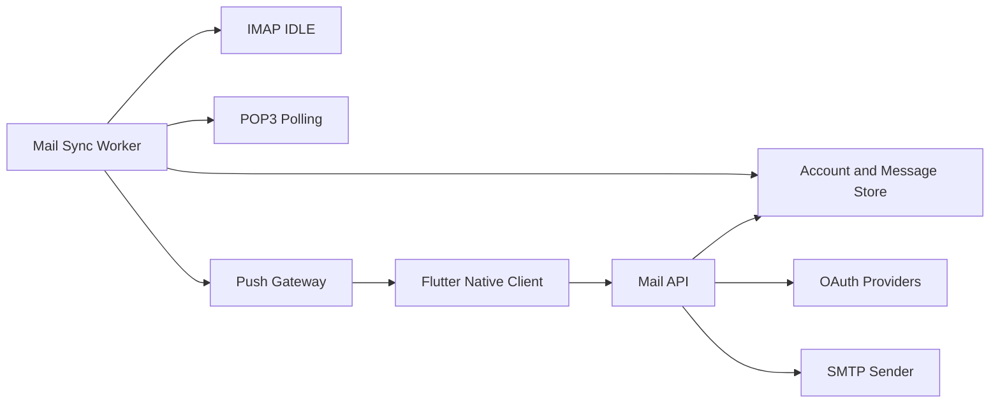

# DailyPostBox

[](https://github.com/littlebit0/DailyPostBox/actions/workflows/ci.yml)

DailyPostBox는 여러 이메일 계정을 한곳에서 관리하는 Flutter 네이티브 메일
클라이언트와 TypeScript 동기화 서버입니다. Gmail, Outlook, 네이버, 다음 및 사용자
지정 메일 서버를 지원하는 것을 목표로 하며, IMAP 계정은 서버가 장기 연결을
유지해 실시간에 가까운 수신 환경을 제공합니다.

> DailyPostBox는 현재 개발 중입니다. macOS 개발 빌드로 주요 흐름을 확인할 수
> 있지만, 운영용 데이터베이스와 비밀정보 저장소 및 푸시 제공자는 아직 연결되지
> 않았습니다.

## 현재 구현

- Gmail OAuth 2.0 브라우저 로그인, PKCE 및 액세스 토큰 갱신
- 네이버 2단계 인증 및 애플리케이션 비밀번호 기반 연결 안내
- Gmail, Outlook, 네이버, 다음 및 사용자 지정 서버 설정 레지스트리
- IMAP 계정 추가 전 수신과 SMTP 발신 연결 검증
- 계정별 메일함, 동기화, 연결 재검사 및 계정 삭제
- 최근 100개, 500개, 1,000개, 전체 또는 이전 메일 미가져오기 선택
- IMAP IDLE 감시, 연결 재시도 및 계정별 수동 동기화
- IMAP 메일 본문 조회와 HTML 링크 제목 기반 하이퍼링크 표시
- 연결된 계정의 SMTP를 이용한 메일 작성 및 발송
- 한국어 및 영어 인터페이스
- macOS 개발 빌드와 Android, iOS, Windows용 Flutter 프로젝트 구조

## 제공자 로그인

| 제공자 | 로그인 방식 | 현재 상태 |
| --- | --- | --- |
| Gmail | OAuth 2.0 브라우저 로그인 | 구현됨, 공개 배포 전 Google 검증 필요 |
| Outlook / Microsoft 365 | OAuth 2.0 브라우저 로그인 | 흐름 구현됨, 실제 앱 등록 검증 필요 |
| 네이버 메일 | 2단계 인증 + 애플리케이션 비밀번호 | 구현됨 |
| 다음 / 카카오 메일 | 비밀번호 또는 앱 비밀번호 | 연결 검증 흐름 구현됨 |
| 사용자 지정 서버 | 비밀번호 또는 앱 비밀번호 | 수동 설정 흐름 구현됨 |

네이버는 외부 메일 앱의 POP3/IMAP/SMTP 연결에 일반 로그인 비밀번호를 허용하지
않습니다. DailyPostBox는 네이버 계정에서 일반 비밀번호 방식을 노출하지 않으며,
애플리케이션 비밀번호와 IMAP/SMTP 활성화 절차를 안내합니다.

## Architecture



모바일 운영체제에서는 백그라운드 상태의 장기 IMAP 연결을 안정적으로 유지하기
어렵기 때문에 서버가 IMAP 연결을 담당합니다. 클라이언트는 푸시 알림을 받은 뒤
API를 통해 계정별 메일 목록을 갱신합니다.

현재 개발 환경은 로컬 JSON 파일에 계정과 메일 메타데이터를 보관합니다. 운영
환경에서는 영구 데이터베이스와 Vault/KMS 기반 비밀정보 저장소로 교체해야 합니다.

## 저장소 구조

```text
.
|-- apps/
|   |-- client/   # Flutter 네이티브 애플리케이션
|   `-- server/   # TypeScript API, OAuth 및 메일 동기화 워커
|-- .github/      # CI 및 GitHub 템플릿
`-- README.md
```

## 시작하기

### 필요 환경

- Flutter stable 및 Dart 3.6 이상
- Node.js 22 이상
- pnpm 10 이상

### 서버 실행

```bash
cd apps/server
cp .env.example .env
corepack enable
pnpm install
pnpm dev
```

API는 기본적으로 `http://127.0.0.1:4000`에서 실행됩니다. 로컬 상태 파일은
`apps/server/.data/local-state.json`에 생성되며 Git에 포함되지 않습니다.

### 클라이언트 실행

```bash
cd apps/client
flutter pub get
flutter run -d macos \
  --dart-define=MAIL_API_BASE_URL=http://127.0.0.1:4000
```

릴리스 빌드에서는 `MAIL_API_BASE_URL`을 공개 HTTPS API 주소로 지정해야 합니다.

### Gmail OAuth 설정

Google Cloud에서 OAuth 클라이언트를 만든 뒤 승인된 리디렉션 URI를 아래 형식으로
등록합니다.

```text
https://<API 도메인>/auth/gmail/callback
```

서버의 `.env`에는 다음 값을 설정합니다. 실제 값은 절대 커밋하지 마세요.

```bash
OAUTH_REDIRECT_BASE_URL=https://<API 도메인>
GOOGLE_OAUTH_CLIENT_ID=...
GOOGLE_OAUTH_CLIENT_SECRET=...
```

Google OAuth 앱이 테스트 상태라면 등록된 테스트 사용자만 로그인할 수 있습니다.
Gmail 전체 메일 접근 권한으로 공개 배포하려면 Google OAuth 앱 검증이 필요합니다.

## 검증

```bash
cd apps/client
flutter analyze
flutter test

cd ../server
pnpm typecheck
```

GitHub Actions는 `main` 브랜치의 Flutter 분석/테스트와 TypeScript 타입 검사를
자동으로 실행합니다.

## 개발 현황

| 영역 | 상태 |
| --- | --- |
| macOS 계정 관리 및 계정별 메일 UI | 구현됨 |
| Gmail OAuth 로그인 및 토큰 갱신 | 구현됨 |
| 네이버 앱 비밀번호 연결 흐름 | 구현됨 |
| IMAP IDLE, 본문 조회 및 SMTP 발신 | 구현됨 |
| POP3 UIDL 기반 실제 수신 | 예정 |
| 첨부파일 표시 및 발송 | 예정 |
| 운영용 데이터베이스 및 암호화 비밀정보 저장소 | 예정 |
| FCM/APNs/Windows 운영용 푸시 전송 | 예정 |
| Android, iOS, Windows 배포 패키징 | 예정 |

클라이언트와 서버의 상세 내용은
[apps/client/README.md](apps/client/README.md)와
[apps/server/README.md](apps/server/README.md)에서 확인할 수 있습니다.

## 보안

OAuth 클라이언트 보안 비밀, 메일 비밀번호, 애플리케이션 비밀번호, 갱신 토큰 및
`.env` 파일을 절대 커밋하지 마세요. 현재 `DevelopmentSecretResolver`와 로컬 파일
저장소는 개발 전용이며 운영 배포에 사용하면 안 됩니다. 민감한 취약점은 공개 이슈
대신 GitHub 비공개 취약점 신고 기능을 이용해 주세요. 자세한 내용은
[SECURITY.md](SECURITY.md)를 참고하세요.

## 기여

버그 신고와 범위가 명확한 풀 리퀘스트를 환영합니다. 변경 사항을 제출하기 전에
[CONTRIBUTING.md](CONTRIBUTING.md)를 읽어주세요.

## 라이선스

아직 오픈 소스 라이선스가 정해지지 않았습니다. 모든 권리는 저작권자에게 있습니다.
