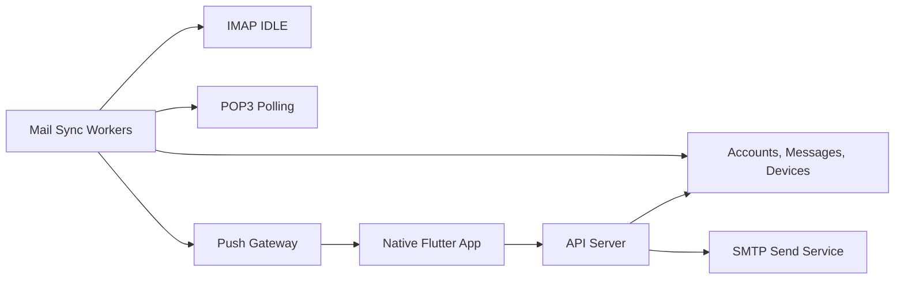

# DailyPostBox Server

IMAP, POP3, SMTP 기반의 범용 메일 앱을 위한 백엔드 스타터입니다.

## 목표

- Gmail, Outlook, Naver, Daum 같은 주요 제공자를 우선 지원
- 기타 회사/개인 도메인은 계정별 수동 IMAP/POP3/SMTP 설정으로 지원
- 수신은 IMAP IDLE 우선, POP3는 폴링 방식으로 처리
- 발신은 SMTP를 공통 인터페이스로 처리
- Android, iOS, macOS, Windows 네이티브 앱에는 푸시 알림과 동기화 API만 노출

## 권장 아키텍처



## 실행

```bash
npm install
npm run dev
```

Gmail 브라우저 로그인을 배포 환경에 설정하는 방법입니다.

1. [Google Cloud Console](https://console.cloud.google.com/)에서 프로젝트를 만듭니다.
2. **Google Auth Platform**에서 앱을 등록합니다. 개인 테스트 용도라면 사용자 유형을 **External**로 선택하고, 테스트 사용자에 본인 Google 계정을 추가합니다.
3. **Clients**에서 **Create client**를 누르고 애플리케이션 유형은 **Web application**을 선택합니다.
   승인된 redirect URL에는 `https://api.dailypostbox.com/auth/gmail/callback`을 등록합니다.
4. 생성된 Client ID를 프로젝트 루트의 `.env` 파일에 넣습니다. `.env.example`을 복사해 시작하면 됩니다.
5. Client ID와 Secret은 배포 플랫폼의 비밀 환경변수에만 저장하고 서버를 배포합니다.

```bash
OAUTH_REDIRECT_BASE_URL=https://api.dailypostbox.com
GOOGLE_OAUTH_CLIENT_ID=...
GOOGLE_OAUTH_CLIENT_SECRET=...
```

개발 중에는 Google의 테스트 사용자만 로그인할 수 있습니다. Gmail 전체 접근 권한은 민감한 권한이므로, 다른 사용자에게 배포할 때는 Google OAuth 검증 절차가 필요합니다.

현재 코드는 앱의 틀입니다. 실제 운영 전에는 데이터베이스 저장소, 암호화 키 관리, 토큰 갱신 저장소, 푸시 제공자 연동을 붙여야 합니다.

## Cloud Run 배포 준비

`Dockerfile`과 `cloudbuild.yaml`은 Google Cloud Run 배포용입니다. 배포 환경에는 `.env` 파일을 올리지 말고 아래 환경변수를 Secret Manager로 주입합니다.

```bash
OAUTH_REDIRECT_BASE_URL=https://api.dailypostbox.com
GOOGLE_OAUTH_CLIENT_ID=...
GOOGLE_OAUTH_CLIENT_SECRET=...
```

Cloud Run 서비스가 준비되면 `api.dailypostbox.com` DNS를 서비스 도메인에 연결하고, Google OAuth Client의 승인된 redirect URL도 `https://api.dailypostbox.com/auth/gmail/callback`으로 유지합니다.

## 포함된 코드

- `providerRegistry`: Gmail, Outlook, Naver, Daum, Custom 제공자 설정
- `ImapReceiver`: IMAP 연결, 최신 메일 조회, IDLE 감시 골격
- `Pop3Receiver`: POP3 폴링 구현 위치
- `SmtpSender`: SMTP 발신 골격
- `MailSyncWorker`: 계정별 실시간 감시/폴링과 푸시 알림 연결
- `PushNotifier`: FCM/APNs/Web Push로 교체 가능한 알림 인터페이스
- `routes`: 제공자 조회, 계정 추가, 받은편지함, 메시지 상세, 메일 발신, 푸시 토큰 등록 API

## 현재 API

- `GET /health`
- `GET /providers`
- `GET /accounts`
- `POST /accounts`
- `POST /accounts/validate`
- `DELETE /accounts/:id`
- `POST /accounts/:id/validate`
- `POST /accounts/:id/sync`
- `GET /accounts/:id/messages`
- `POST /auth/:providerId/start`
- `GET /auth/:providerId/callback`
- `GET /auth/sessions/:state`
- `GET /mail/inbox`
- `GET /mail/messages/:id`
- `POST /mail/send`
- `POST /devices/push-token`

`POST /accounts`가 호출되면 서버는 계정을 저장하고 즉시 `MailSyncWorker`에 넘겨 IMAP IDLE 또는 POP3 폴링을 시작합니다.

## 다음 구현 순서

1. 계정/메시지/디바이스 테이블 설계
2. OAuth 로그인: Gmail, Outlook 우선
3. 앱 비밀번호 또는 수동 비밀번호 계정: Naver, Daum, 기타 IMAP/SMTP
4. IMAP IDLE 워커와 POP3 폴링 워커 분리
5. FCM/APNs 푸시 토큰 등록
6. 첨부파일 저장소와 바이러스 스캔
7. 검색 인덱스

## 보안 원칙

- 메일 계정 비밀번호와 refresh token은 반드시 envelope encryption으로 저장
- SMTP/IMAP 연결 정보는 로그에 남기지 않기
- OAuth provider별 scope는 최소화
- 푸시 알림 본문에는 민감정보를 최소화하고 앱 내부에서 상세 조회
